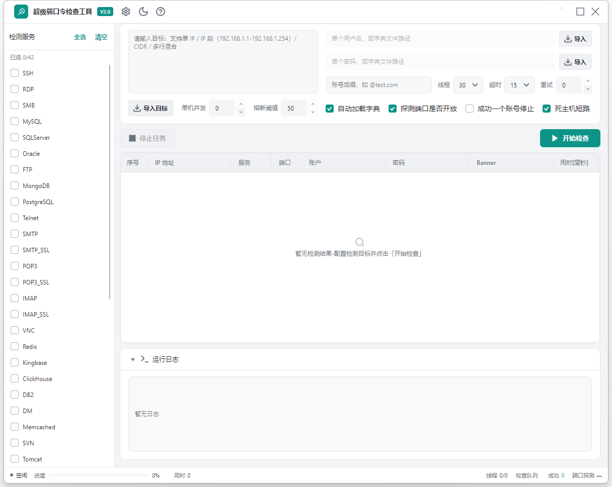

# SNETCracker V2 · 超级弱口令检查工具

[](https://github.com/shack2/SNETCracker/actions/workflows/release.yml)
[](https://github.com/shack2/SNETCracker/releases/latest)
[](LICENSE)

跨平台弱口令/弱密码检测工具，支持 **42 种协议** 的密码验证，提供 **GUI 客户端** 与 **命令行（spc）** 双形态。

V2 为全新重写版本（Avalonia + Native AOT，全协议自实现）。旧版 WinForms 代码见 `v1-legacy` 标签。



## 特性

- **42 种协议**：SSH / RDP / SMB / MySQL / SQLServer / PostgreSQL / Oracle / Redis / MongoDB / FTP / Telnet / VNC / SNMP / LDAP / WinRM / HTTP(S) / SMTP / POP3 / IMAP / MQTT / Kafka / RabbitMQ / ActiveMQ / Zookeeper / Cassandra / Neo4j / Elasticsearch / Memcached / SVN / Tomcat / WebLogic / DB2 / DM / Kingbase / ClickHouse / Rsync 等
- **协议自实现**：SSH/MySQL/PG/Oracle/TDS/Mongo/Redis/FTP/邮件等均为最小化纯 C# 实现，零重型第三方依赖
- **Native AOT**：单文件免安装，Windows / Linux / macOS 全平台
- **大网段优化**：CIDR 批量目标、死主机短路、单机并发限流、账号熔断防锁定（严格锁定策略环境建议把「熔断阈值」调到 5~10）、SSH 单连接多密码复用
- **CLI（spc）**：stdout 只输出命中结果（`[+]` 行 / JSON），可直接作为脚本或 AI 智能体工具调用

## 下载与运行

见 [Releases](https://github.com/shack2/SNETCracker/releases)：

| 包 | 平台 | 内容 |
| --- | --- | --- |
| `SNETCracker_<版本>_win-x64.zip` | Windows x64 | GUI + spc.exe + config |
| `SNETCracker_<版本>_linux-x64.tar.gz` | Linux x64 | GUI + spc + config |
| `SNETCracker_<版本>_osx-x64.tar.gz` | macOS Intel | 同上 |
| `SNETCracker_<版本>_osx-arm64.tar.gz` | macOS Apple Silicon | 同上 |
| `SPasswordCheckerV2.SKILL_<版本>.zip` | Kimi 智能体技能包 | SKILL.md + spc.exe + config |

**Linux**：tar 包已保留可执行位；GUI 需要系统装有 fontconfig 等常见桌面库（纯 CLI 的 `spc` 无此依赖）。

**macOS**：首次运行如被 Gatekeeper 拦截（未签名包），执行：
```bash
xattr -d com.apple.quarantine SPasswordCheckerV2 spc
chmod +x SPasswordCheckerV2 spc   # 若直接下载的是 zip 包
```

**Windows**：未做代码签名，SmartScreen 可能提示，选择「仍要运行」即可。

## CLI 用法

```bash
# 单目标 + 单账号密码
spc -t 192.168.1.10 -s ssh -u root -p 123456

# 网段 + 字典 + JSON 输出（stdout 只出命中行，日志走 stderr）
spc -t 192.168.1.0/24 -s ssh,mysql --json -q

# 检查更新
spc --update
```

完整参数见 `spc --help`。

## 构建

```bash
dotnet publish SPasswordCheckerV2/SPasswordCheckerV2.csproj -c Release -r win-x64      # GUI
dotnet publish SPasswordCheckerV2.Cmd/SPasswordCheckerV2.Cmd.csproj -c Release -r win-x64  # CLI
```

发版：打 `v*` 标签并推送，GitHub Actions 自动构建四平台包、创建 Release，并同步到自建更新服务。

## 项目结构

| 目录 | 说明 |
| --- | --- |
| `SPasswordCheckerV2/` | Avalonia GUI 客户端 |
| `SPasswordCheckerV2.Cmd/` | 命令行版本（spc） |
| `shack2.pass.checker/` | 协议检测核心库（42 协议自实现 + 扫描引擎） |
| `SPasswordCheckerV2.SKILL/` | Kimi 智能体技能包定义 |

## 声明

本工具仅供**授权安全测试**与自查使用，请遵守当地法律法规，勿对未授权目标使用。
